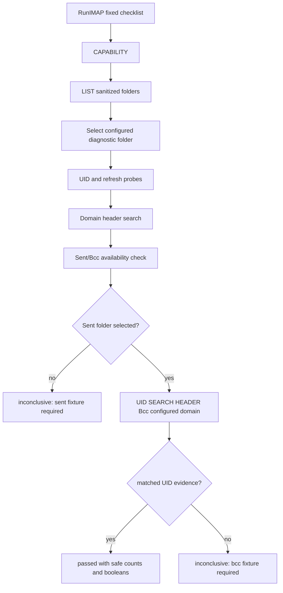

## Goal Capsule

| Field | Value |
|---|---|
| Objective | Extend `ksuite-mail probe imap --account <account-ref> --json` so the fixed daemon-side provider probe reports sanitized Sent folder behavior and confirms or marks inconclusive whether sent-message `Bcc` availability can support domain policy decisions. |
| Authority | GitHub issue #20, `docs/requirements.md` FR-014, `docs/non-functional-requirements.md` NFR-PRV-004, `docs/architecture-arc42.md` ADR-007 and provider-probe constraints, and `docs/uat/infomaniak-imap-probe.md` UAT-IMAP-PROBE-006. |
| Execution profile | Standard Go implementation in the existing provider-probe path, with deterministic fake IMAP coverage and UAT documentation updates. |
| Stop conditions | Stop if implementation would expose sent message subjects, bodies, raw headers, attachment names, raw provider text, credentials, arbitrary IMAP responses, or a raw IMAP command surface. |
| Tail ownership | LFG owns implementation, review fixes, local verification, PR creation against `main`, and CI follow-up unless a product/security conflict appears. |

---

## Product Contract

### Summary

Issue #20 extends the fixed provider probe with the last Sent-mail-specific policy input needed for domain accounts: whether the selected account has a discoverable Sent folder and whether a controlled sent-message `Bcc` fixture is searchable enough to support domain policy matching.

### Problem Frame

Domain policy matching can use `Bcc` mainly for sent mail, but providers may omit or hide `Bcc` data.
The probe must make that provider behavior explicit without turning Sent mail into a content-inspection surface.
Folder listing may be broader than configured folders for Sent discovery, but message-level checks must remain bounded to daemon-selected diagnostic targets for the selected account.

### Requirements

- R1. The probe reports Sent folder behavior using sanitized folder diagnostics derived from the provider folder listing.
- R2. The probe confirms sent-message `Bcc` availability when a controlled sent fixture produces safe positive evidence.
- R3. The probe reports `inconclusive` when Sent or `Bcc` fixture evidence is missing, rather than claiming supported or unsupported behavior.
- R4. The probe does not return sent message subjects, bodies, raw headers, attachment names, raw provider text, arbitrary IMAP responses, or credentials.
- R5. Message-level Sent/Bcc checks stay bounded to daemon-selected diagnostic targets for the selected account; broad folder listing is used only to choose safe Sent diagnostics.
- R6. Automated tests cover Sent folder discovery, Bcc available, Bcc unavailable or inconclusive, missing fixtures, and sanitized-error behavior through fake IMAP behavior.
- R7. UAT-IMAP-PROBE-006 documents Sent folder and Bcc availability outcomes.

### Acceptance Examples

- AE1. Given the provider lists `INBOX` and `Sent`, and the configured domain account has a sent fixture whose `Bcc` search returns a UID for the configured domain, when the probe runs, then it reports the Sent/Bcc check as `passed` with safe facts such as the Sent folder name, discovery source, and matched UID count.
- AE2. Given no Sent-like folder is discoverable from provider folders or configured folders, when the probe runs, then the Sent/Bcc check is `inconclusive` with a stable code and does not run message-level checks against arbitrary folders.
- AE3. Given a Sent folder exists but the controlled `Bcc` fixture is missing or unsearchable, when the probe runs, then the Sent/Bcc check is `inconclusive` and does not report provider behavior as unsupported.
- AE4. Given a provider or fake source returns an error containing private text during Sent/Bcc probing, when the probe serializes JSON, then the detail remains sanitized as `provider probe failed` and no raw provider text or sent content appears.

### Scope Boundaries

- In scope: provider-probe check sequencing, safe API facts, Sent discovery from sanitized folder names, fake source behavior, focused provider-probe tests, and UAT wording.
- Out of scope: changing CLI arguments, adding raw IMAP commands, live Infomaniak access in CI, returning message content, caching Sent/Bcc probe data, or implementing production policy matching from Sent mail.
- Deferred to follow-up work: local policy/cache behavior that consumes the discovered `Bcc` availability; this slice only reports provider capability evidence.

### Sources

- GitHub issue #20: Sent-mail policy probe.
- `docs/requirements.md`: FR-014 Fixed Provider Probe and minimum fixture coverage.
- `docs/non-functional-requirements.md`: NFR-PRV-004 Bcc limits and probe fixture expectations.
- `docs/architecture-arc42.md`: provider-probe privacy boundary and ADR-007 required probe areas.
- `docs/uat/infomaniak-imap-probe.md`: UAT-IMAP-PROBE-006 Sent Folder And Bcc Availability.

---

## Planning Contract

### Key Technical Decisions

- KTD1. Add a dedicated Sent/Bcc check instead of overloading `domain_header_search`.
  The current `domain_header_search` already probes `Bcc` in a configured Sent folder, but issue #20 requires an explicit statement about Sent folder behavior and Bcc availability.
  A separate check keeps existing domain-search semantics stable and makes the new provider fact easier for agents to consume.
- KTD2. Discover Sent folders from sanitized folder listings, then pick one daemon-selected diagnostic target.
  FR-014 allows safe folder names and issue #20 allows broader folder listing for Sent discovery, but message-level checks must run only against the chosen diagnostic folder.
- KTD3. Treat missing Sent or missing Bcc evidence as `inconclusive`.
  Missing evidence is not proof of provider support or lack of support; it may mean fixtures are absent or the provider hides Bcc data.
- KTD4. Extend typed `ProbeFacts` rather than adding an open map.
  `internal/api.ProbeFacts` intentionally prevents arbitrary provider text from entering probe responses, so Sent/Bcc facts should use explicit scalar fields or typed structs.

### High-Level Technical Design

### Assumptions

- Sent discovery can start with a conservative folder-name matcher over sanitized folder names, including configured folders and broader provider `LIST` output.
- The first implementation does not need to identify every localized Sent folder variant; it should be structured so additional aliases can be added without changing the response contract.
- Existing fake adapter search-result controls are sufficient for Bcc availability tests unless implementation reveals a need for a small helper around folder discovery fixtures.

### System-Wide Impact

The change stays inside the fixed probe path and API payload types.
It must preserve the CLI/daemon credential boundary, the no-content diagnostic contract, and the search-before-fetch privacy posture for domain accounts.

---

## Implementation Units

### U1. Add Sent/Bcc Probe Response Facts

- **Goal:** Define a typed, safe response shape for Sent folder behavior and sent-message `Bcc` availability.
- **Requirements:** R1, R2, R3, R4.
- **Dependencies:** None.
- **Files:** `internal/api/api.go`, `internal/providerprobe/imap_test.go`.
- **Approach:** Extend `api.ProbeFacts` with explicit Sent/Bcc fields or a small typed struct that can represent the selected Sent folder, whether discovery used provider folder listing, matched UID count, and Bcc availability as passed/inconclusive facts.
  Keep facts scalar and content-free; do not expose raw headers, message IDs beyond safe counts, subjects, or provider text.
- **Patterns to follow:** Existing `DomainHeaderSearch` and `read_state_preserved` facts in `internal/api/api.go`; leak assertions in `internal/providerprobe/imap_test.go`.
- **Test scenarios:**
  - Happy path: marshaling a Sent/Bcc fact omits empty fields and includes only safe scalar fields.
  - Error path: a probe failure containing private provider text serializes only the stable sanitized detail.
  - Privacy regression: serialized probe JSON does not contain fixture subject/body/header/provider-error substrings.
- **Verification:** Tests assert the JSON response carries typed Sent/Bcc facts and no raw content-bearing fields.

### U2. Implement Sent Folder Discovery and Bcc Availability Check

- **Goal:** Add a fixed checklist check that reports Sent folder behavior and Bcc availability without widening message-level probing.
- **Requirements:** R1, R2, R3, R4, R5.
- **Dependencies:** U1.
- **Files:** `internal/providerprobe/imap.go`, `internal/providerprobe/imap_test.go`, `internal/mailfake/fake.go` if helper behavior is needed.
- **Approach:** Add a new check ID such as `sent_bcc_availability`.
  Reuse the sanitized `Folders` result for discovery, choose one daemon-selected Sent diagnostic target, and then call `SearchAllowed` for `Bcc` only on that selected Sent target and configured domain values.
  For full-policy accounts, return `not_applicable` because the check exists to support domain-policy decisions; for domain-policy accounts with no domains, return `inconclusive`.
  Preserve existing `domain_header_search` behavior unless implementation finds duplicated Bcc work should be internally shared without changing its output.
- **Execution note:** Start with failing provider-probe matrix tests for AE1-AE4 before changing the runner.
- **Patterns to follow:** `probeDomainHeaders`, `probeReadState`, `probeFailure`, `domainProbeNotRun`, and `sentProbeFolder` in `internal/providerprobe/imap.go`.
- **Test scenarios:**
  - Covers AE1. Provider lists a Sent folder and fake search returns a Bcc UID for a configured domain; the new check passes and facts include matched count without content.
  - Covers AE2. Provider folders contain no Sent candidate; the new check is `inconclusive` with a stable missing-Sent code and no `search` call runs against an arbitrary folder.
  - Covers AE3. Sent folder exists but Bcc search returns no fixture UID; the new check is `inconclusive`, not failed or unsupported.
  - Covers AE4. Sent/Bcc `SearchAllowed` returns a private-text error; the check fails with a sanitized code/detail and response leak assertions pass.
  - Policy boundary: full-policy accounts report the Sent/Bcc availability check as `not_applicable` and do not run Bcc message-level searches.
  - Edge case: multiple folders contain Sent-like names; the selected target is deterministic and recorded as a safe folder fact.
  - Integration scenario: existing domain read-state probe still uses only same-folder validated evidence and does not preview Sent/Bcc evidence from another folder.
- **Verification:** Focused provider-probe tests prove the check order, status codes, bounded target selection, and no-content response guarantee.

### U3. Extend UAT Scenario 006

- **Goal:** Document the expected manual outcome shape for Sent folder and Bcc availability probing.
- **Requirements:** R7.
- **Dependencies:** U1, U2.
- **Files:** `docs/uat/infomaniak-imap-probe.md`.
- **Approach:** Update UAT-IMAP-PROBE-006 so the expected behavior names sanitized Sent discovery, Bcc availability as passed or inconclusive, and the no-content boundary.
  Keep raw artifacts local under `.uat-runs/` and avoid adding live mailbox artifacts to the repo.
- **Patterns to follow:** Existing UAT-IMAP-PROBE-004 and UAT-IMAP-PROBE-005 scenario wording.
- **Test scenarios:** Test expectation: none -- this unit is documentation-only and is verified by review against issue #20 acceptance criteria.
- **Verification:** UAT text is explicit enough for a manual run to classify `passed`, `failed`, `inconclusive`, or `not_run` without exposing sent content.

---

## Verification Contract

| Gate | Applies To | Done Signal |
|---|---|---|
| `make fmt` | U1-U2 | Go files are formatted. |
| `make test` | U1-U3 | Unit and integration tests pass, including Sent folder discovery, Bcc available, Bcc inconclusive, missing fixture, and sanitized-error cases. |
| `make test-e2e` | U2-U3 | Hermetic e2e tests still pass without real Infomaniak credentials. |
| `make lint` | U1-U2 | `go vet` and `golangci-lint` pass. |
| `make gate` | Whole slice | Full local pre-PR gate passes or any environment-only blocker is documented in the PR. |

---

## Definition of Done

- `ksuite-mail probe imap --account <account-ref> --json` includes a stable Sent/Bcc availability check in the fixed daemon-side checklist.
- Sent folder behavior is reported with sanitized folder diagnostics only.
- Sent-message `Bcc` availability is confirmed only with controlled fixture evidence; missing evidence is `inconclusive`.
- No sent message content, raw headers, attachment names, raw provider text, credentials, or arbitrary IMAP responses appear in probe output or logs.
- Automated tests cover issue #20 acceptance criteria through fake IMAP behavior.
- UAT-IMAP-PROBE-006 describes the expected Sent/Bcc outcome shape.
- The final diff contains no dead-end experimental code and the PR targets `main` from branch `issue-20-sent-mail-policy-probe`.
